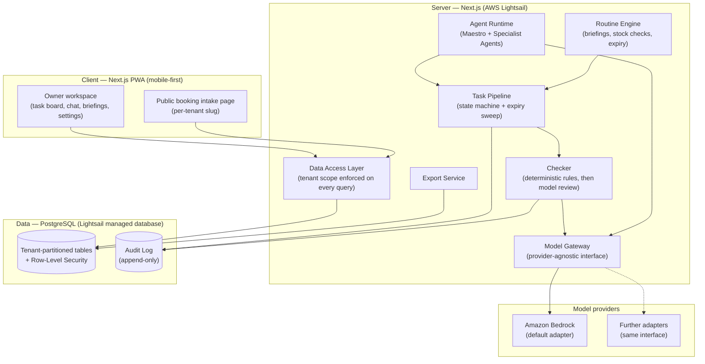
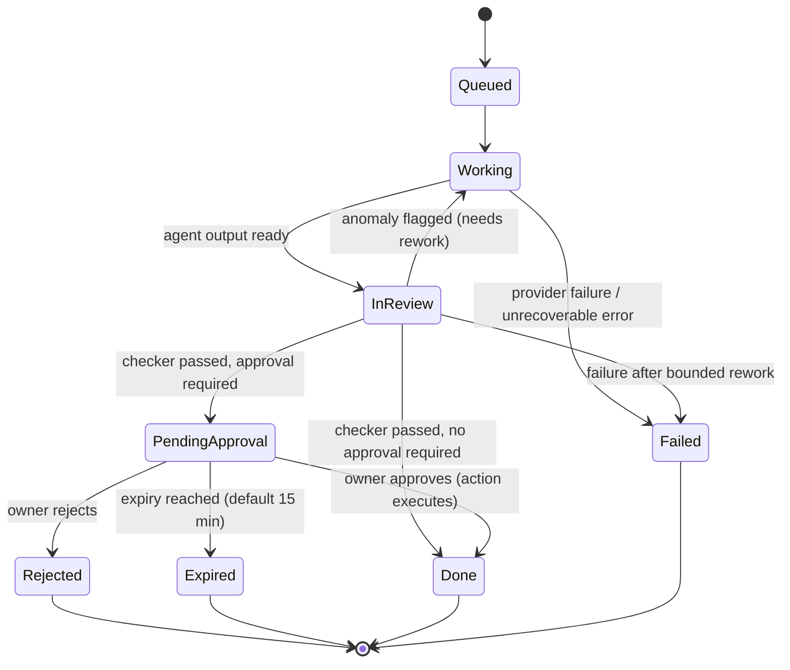
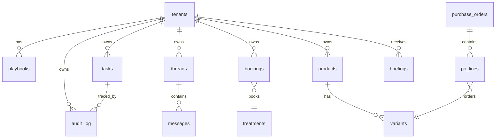

# Design Document — Aruna Core

**Project:** Aruna Core — one AI agent skeleton for small businesses, proven by two applications
**Competition:** Kiroween 2026 (Devpost) · Category: **Skeleton Crew** · Bonus claimed: Best Startup Project
**Status:** APPROVED v1.4 — Gate 2 PASSED 19 Nov 2026 (founder verdict: PASS all). Amended to v1.4 on 19 Nov 2026: the accepted findings of the GPT-6.1 Sol spec review (amendments #1–22, #25, #29) were applied per the founder's PASS on Elsa's evaluation of that review. Stack (AWS Activate), framework + mobile path, and build account (Google sign-in, Kiroween credits) decided by the founder, 19 Nov 2026.
**Companion documents:** `requirements.md` (Gate 1: PASSED 18 Nov 2026, unchanged) · `tasks.md` (Gate 3, next)

---

## Overview

Aruna Core is a multi-tenant web application in which a single codebase becomes a working business application purely by loading a tenant's **Playbook**. The design has three layers:

1. **Core (the skeleton)** — tenancy and data separation, Playbook loading and validation, the owner workspace, chat with the Maestro and Specialist Agents, the task pipeline with Checker and Approval Gates, the append-only Audit Log, the daily Briefing routine, data export, and a provider-agnostic Model Gateway.
2. **Vertical Packs** — small domain modules plugged into the core: the **Services Pack** (treatments + bookings, for Denana) and the **Retail Pack** (variants + stock + purchase orders, for Toko Seragam). A pack contributes entities, deterministic checks, routines, and briefing sections; it never re-implements pipeline, approval, or audit behaviour.
3. **Playbooks** — one configuration document per tenant (business profile, catalog, hours, thresholds, templates, active pack, assistant display name). Two Playbooks ship with the project: Denana and Toko Seragam.

Every agent output travels the same road: **Agent → Task → Checker → (Approval Gate if external or money-adjacent) → Done**, with the Audit Log recording each step. The AI model proposes; deterministic rules and the owner dispose. In particular, no payment state ever changes on a model's say-so (constraint C3).

This design also settles, at design level, the three architecture questions carried over from the founder's 7 Nov 2026 session: (1) tenant data separation — §2.1 and §3; (2) data export on tenant exit — §2.9; (3) online/offline relationship — §2.10 (design only; offline synchronisation is out of scope for this slice per the requirements).

## Architecture



### Technology decisions (settles Open Item 1 of the requirements)

| Concern | Decision | Why |
|---|---|---|
| Framework | Next.js (App Router, TypeScript) as an installable PWA | One codebase for UI + server logic; mobile-first owner experience; blueprint default |
| Database | PostgreSQL (AWS Lightsail managed database) | Tenant partitioning + Row-Level Security in the database itself; paid from the owned AWS Activate credit pool ($5,100, valid to Nov 2028) rather than an unowned free tier |
| Auth | Application-level credentials auth (Auth.js credentials provider; database sessions; passwords hashed with argon2id in PostgreSQL) | One owner account per tenant in this slice (Open Item 2); evaluator accounts are seeded, credentials documented only in the submission (R11.3); no external auth service to provision; database sessions make session revocation real (§2.9) |
| Hosting | AWS Lightsail (application instance + system cron) | Paid from the owned AWS Activate pool — the same account already running production n8n, Bedrock, and the budget kill-switch; no free-tier pause or cron-frequency limits; system cron drives the Routine Engine and the approval-expiry sweep |
| Model access | Model Gateway with an Amazon Bedrock adapter as default | Brains already validated by PahamAI's Tier-1/2/3 batteries run on Bedrock; per-tenant provider/model stays configurable (R10) |
| Validation | Schema validation (Zod) for Playbooks and agent outputs | Activation refuses incomplete Playbooks with an exact missing-field list (R2.3); agent output is never trusted unparsed |
| Testing | Vitest (unit + property-style tests) and Playwright (end-to-end smoke) | Correctness properties in §4 map to these tests |

**Auth and operations contract (minimum, binding; amendment #29).** Auth.js runs with the credentials provider and **database sessions** (not stateless tokens), so revoking a session actually ends it — deactivation depends on this (§2.9). Passwords are hashed with **argon2id**; plaintext or reversible storage is forbidden. Accounts are **provisioned by seeding/operator action only** — there is no self-serve signup in this slice; evaluator and owner accounts are created by the seed script or an operator, and operator accounts are provisioned the same way (§2.9). The runtime configuration is a fixed environment contract: database connection strings per role (migration owner, application runtime, service/routine — §2.1), the Auth.js secret, the Bedrock adapter configuration, and the cron secret. **Cron/routine invocation is never public:** scheduler endpoints accept only calls carrying the cron secret header or originating from localhost on the instance.

### Client separation and the mobile path

**Architectural rule (binding on all build tasks):** every business behaviour lives behind the server-side boundary — the Data Access Layer, the task pipeline, the Checker, the Approval Gate, and the Model Gateway. The web UI is *one client* of that boundary; no business rule may exist only in UI code, and every UI action maps to a server operation that any future client could call. This keeps the platform's value (tenancy, pipeline, safety gates, Playbooks) independent of any screen technology.

**Framework decision (founder, 19 Nov 2026):** this slice is built in Next.js. The alternatives were weighed explicitly: Expo / React Native (one codebase for web + iOS + Android, but a new toolchain mid-sprint and a heavier web result for a data-dense workspace) and Flutter (a different language; nothing of the existing TypeScript stack carries over). Next.js was chosen because the competition is judged on a live web application used from a phone, the founder's existing products already run on the same TypeScript / Next.js stack, and the sprint leaves no room for a toolchain learning curve. The accepted cost: a future native client means rebuilding the screen layer — never the backend.

**Mobile path (post-competition, in order):**
1. **PWA (this slice)** — installable from the browser; mobile-first workspace.
2. **Capacitor wrapper** — the same web build packaged as store applications for Android and iOS, with no rebuild.
3. **React Native client (only if proven necessary)** — a native client against the same server API, reusing tenancy, pipeline, Checker, gateway, and Playbooks unchanged; TypeScript skills and types carry over from the web build.

---

## Components and Interfaces

### 2.1 Tenancy and the Data Access Layer

Multi-tenancy uses a **shared schema with a tenant discriminator**: every business table carries `tenant_id`, and Postgres **Row-Level Security (RLS)** policies restrict every row to the tenant bound to the caller's session. The caller's tenant is resolved server-side from their profile record — never from client-supplied parameters — and is applied to the database session (`SET LOCAL app.tenant_id`) so the policies enforce it on every query.

Rules that make separation structural rather than conventional:

- All application data access goes through the **Data Access Layer (DAL)**. The DAL resolves the caller's tenant once per request and scopes every query by it. UI components and agents never query the database directly.
- A request that references a record belonging to another tenant is refused (not found / forbidden) and an Audit Log entry of type `security.cross_tenant_attempt` is written under the *caller's* tenant (R1.3).
- Server-side routines (briefing, stock check, expiry sweep) run with a privileged database role that bypasses RLS; they therefore iterate tenants explicitly and write each tenant's records inside that tenant's scope, one tenant at a time. This is the only code path allowed to hold the service role, and it never mixes two tenants' data in one operation.
- The public intake page (§2.8) is the single unauthenticated write path: it may only create a booking-request Task for the tenant identified by the page slug, and it can read nothing.

**Transaction contract (amendment #2).** The DAL is a **single transaction wrapper**, not a collection of scoped queries. Every unit of work runs as: resolve the caller → open one transaction → bind the tenant with a parameterised `SET LOCAL app.tenant_id` inside that transaction → run every query on that same transaction handle → commit or roll back as one. A tenant context can therefore never leak across pooled connections or apply to only some queries of a request. If no tenant context can be established, the wrapper **fails closed**: no query runs at all.

**Database role contract (amendment #3).** Three database roles exist, and no role is shared between purposes:

- **Migration owner** — owns the schema and runs migrations only; the application never connects with it at runtime.
- **Application runtime** — a non-owner role with **no `BYPASSRLS`**. All business tables enable **FORCE ROW LEVEL SECURITY**, so policies bind every access through this role, with no owner exception.
- **Service/routine role** — the only role that bypasses RLS, held only by the server-side routine code path above; it iterates tenants explicitly, one at a time.

The two bootstrap lookups that must happen before a tenant context exists are narrow, documented exceptions, not general queries: the **profile lookup** at sign-in (returns only the caller's own tenant binding) and the **slug lookup** for the public intake (returns only the tenant id and public intake data for that slug, §2.8). Tenant-isolation tests must run connected as the **application runtime role** — passing tests under the migration owner prove nothing.

### 2.2 Playbook service

A Playbook is a versioned JSON document stored per tenant (`playbooks` table: one active version per tenant). Loading and activation flow:

1. Parse the document and validate it against the core schema plus the active pack's schema (required catalog shape, thresholds, templates, hours).
2. If any required field is missing or invalid, activation is **refused** and the service returns the exact list of missing/invalid fields (R2.3). The tenant stays inactive; no partial activation exists.
3. On success, the Playbook becomes the tenant's active configuration and seeds the tenant's records: catalog, hours, thresholds, templates, and pack are read from it — so switching the Playbook switches the application the owner sees, with no code change (R2.2).

**Source of truth (amendment #22).** The Playbook is the **initial seed and template**, not a live overlay. Once activation has seeded them, the **database records are authoritative**: catalog rows, stock counts, and settings are what runtime reads, and owner edits to them are the truth from then on. The assistant's display name is owned by `settings` (§3) — the Playbook supplies only its initial value. Re-activation or switching a Playbook therefore follows an explicit merge rule: validate the new Playbook, then seed only what is missing; **activation never silently overwrites owner-edited records** (catalog edits, stock, settings). A conflicting re-activation is surfaced to the owner, not applied over their data.

The two shipped Playbooks (Denana, Toko Seragam) live in the repository under `/playbooks` and are loaded by the seed script, so a fresh clone reproduces both applications exactly (R11.1, R11.2).

### 2.3 Task pipeline

A Task is the single unit of agent work. Its lifecycle is a state machine enforced in one server module — the only place allowed to change a task's status:



- Every transition writes an Audit Log entry (actor, from-state, to-state, timestamp).
- **Failed is a first-class terminal status (amendment #1).** A task whose execution fails — provider failure, malformed output past the retry bound, or rework exhausted (§2.7) — ends in **Failed**: terminal, visible on the board like any other end state, and carrying the recorded error on the task. Failure transitions are reachable from Working and InReview. A Failed task is never silently retried by the system; the **owner may retry it manually**, which records a new execution attempt and returns the task to Queued — the retry and its outcome are audited like any other transition.
- **Audit is atomic with the mutation it records (amendment #5).** A business change and its Audit Log entry commit in the **same database transaction** — both or neither; there is no state in which a mutation exists without its audit entry, or an audit entry claims a mutation that rolled back. Model calls sit outside the database transaction, so they use two separate audit events: an **attempt** event when the call is made and an **outcome** event (usage / failure) when it returns (§2.7).
- **Executor (amendment #14).** There is no separate queue platform in this slice: agent execution runs **inside the request that creates the task** (owner command, intake submission, or routine tick), and every execution attempt is recorded in the Audit Log (attempt start and outcome, linked to the task). A task left in Working by an interrupted execution is recovered by the per-minute cron sweep: a Working task whose attempt has gone stale is returned to Queued for a fresh attempt or, past the failure bound, marked Failed — it never hangs invisibly.
- A task card shows: responsible agent, origin (`routine` | `maestro` | `direct` | `intake`), current status, and its check and approval history (R3.3).
- **Approval expiry** is enforced two ways: a per-minute sweep (system cron on the Lightsail instance) cancels any task whose `approval_expires_at` has passed, and a lazy check applies the same rule whenever a Pending Approval task is read or acted on — so expiry is correct even if the sweep is delayed (R5.4). Expiry cancels the *action*; the task remains visible as Expired. The comparison is explicit and race-free (amendment #8): a task is expired when `approval_expires_at <= now()`, evaluated with **database time inside the same atomic operation** that would approve or execute it (§2.5) — approval and expiry can never both win, and once a task is Expired, **no code path can execute its action**.

### 2.4 Checker

The Checker runs on every agent output before it becomes actionable (R5.1), in a fixed order. Its scope is stated precisely (amendment #10): the Checker gates **executable drafts** — outputs that would change records or be sent. Maestro answers and Briefing summaries are not executable actions and do **not** run through a second Checker pipeline; they are secured by construction instead — their facts come only from typed query results (§2.6, §2.11) — plus the Briefing fidelity property (Property 9).

1. **Deterministic checks (pure functions over source records).** Examples: required fields present; numbers in the output equal the numbers in the source records (prices, quantities, PO references); the recipient matches the source record; a booking's slot does not overlap a confirmed booking; a follow-up draft's item/quantity/PO reference match the flagged record. A failed check marks the task with an **anomaly** describing the exact inconsistency and returns it to Working — the output never passes through silently (R5.2).
2. **Model review (via the Model Gateway).** A second-opinion pass for wording and plausibility on outputs that passed step 1. The model review can flag, never approve past a deterministic failure, and never touches payment state (C3).

**Critical facts are rendered, not written (amendment #11).** In any draft the owner sees or approves, the critical facts — numbers, names, recipients, statuses — are **rendered deterministically from the verified structured fields via templates**. Model free text may connect and phrase the surrounding wording, but it may not introduce any business fact that is not present in those verified fields; what the Checker verified is exactly what the owner reads.

### 2.5 Approval Gate

An action requires approval when it would: send a message externally, create a supplier commitment, or touch payment state (R5.3). In this slice external sending is recorded in-app (per Out of Scope), so the gate governs *sendable* drafts, PO follow-up commitments, booking confirmations, and any payment-adjacent state change.

- Approval and rejection are explicit owner actions in the workspace; both record decider and timestamp in the Audit Log (R5.6).
- **Approval binds to an immutable revision (amendment #7).** A task's payload carries a revision number; the Checker result is recorded against that exact revision, and approval executes **that checked revision — nothing else**. Execution is atomic and idempotent under the task's row lock: the status check, deadline check, action execution, transition, and audit entry happen in one transaction, so a double approval (double tap, retry, two tabs) can never execute the action twice. Any change to the draft increments the revision and **voids the previous Checker result and any pending approval** — the revised draft must pass the Checker again before it can be approved.
- The deadline check inside that transaction uses database time (amendment #8, §2.3): an approval that arrives after `approval_expires_at` finds the task Expired and executes nothing.
- Payment states (`paid`, `settled`, `refunded`) are changed **only** by deterministic rules plus an explicit owner approval event — there is no code path by which a model output sets them (R5.5, C3). Refunds additionally always require the owner's decision; the system never executes a refund (Out of Scope: humans execute payments).

### 2.6 Agents and chat

- **Threads:** one Maestro thread per tenant and one thread per active Specialist Agent (Booking for the Services Pack; Stock for the Retail Pack). The assistant's display name comes from `settings` (initialised from the Playbook at activation, §2.2) and is used in chat, briefings, and the workspace; renaming it in settings takes effect immediately everywhere (R4.4, R4.5).
- **Commands:** a message in any thread is handed to the Agent Runtime, which creates or updates a Task and records the command in the Audit Log — the thread of origin does not change the pipeline (R4.2).
- **Maestro answers from live data:** when the owner asks what an agent is doing, the Maestro answers by querying current tasks and audit entries through typed server-side query functions and composing the reply from those results — never from generated text alone (R4.3).
- **Agent outputs** are structured (schema-validated) drafts attached to their Task; free text is allowed only as the human-readable rendering of a structured draft.

### 2.7 Model Gateway

One interface for all model calls; agent code never imports a provider SDK (R10.1):

```
interface ModelGateway {
  complete(request: {
    tenantId: string               // derived server-side from the execution context — never accepted from client or agent input
    taskId?: string                // the calling Task, when the call belongs to one
    routineContext?: string        // named routine context (e.g. a Briefing run) when there is no Task
    system: string
    messages: Message[]
    responseSchema?: Schema        // when set, output is parsed + validated
  }): Promise<{
    text: string
    parsed?: unknown               // the parsed + validated object, present only when responseSchema was set and parsing succeeded
    usage?: { inputTokens: number; outputTokens: number }
  }>
}
```

**Association is mandatory (amendment #12).** Every Gateway call carries an association — a `taskId`, or a named `routineContext` when the call belongs to a routine rather than a Task — so usage and failures are always attributable to a tenant and a context (R10.3). Structured output is explicit: when `responseSchema` is set, the Gateway parses and validates the output and returns it as `parsed`; a parse or validation failure is a **failed call**, handled by the failure behaviour below — never a silently accepted raw text.

- **Configuration** is per tenant (provider + model), stored with the tenant's settings, with a project default (Bedrock adapter, a validated light model) (R10.2).
- **Usage recording:** every call writes an Audit Log entry of type `model.usage` carrying tenant, task or routine context, provider, model, and token counts when the provider reports them (R10.3). Per amendment #5, the call is preceded by a `model.attempt` audit event and closed by this outcome event.
- **Failure behaviour (amendment #13):** every call has a **per-call timeout**; a timeout is a provider failure, treated exactly like an unreachable provider or an error response. On any failure the calling Task ends in the visible **Failed** state (§2.3) and the failure is audited — the system never substitutes a fabricated result (R10.4). Rework is **bounded**: a task returned to Working (anomaly, malformed output, or a model-review flag) may cycle at most **3 times**; the next failure moves it to Failed instead of looping forever. A fake adapter exists **only** in the test environment, is never wired into a deployed configuration, and is labelled as test-only in code.

### 2.8 Vertical packs and the intake

A pack registers: its entities, its deterministic checks, its routines, its briefing section, and its Playbook schema fragment. The core knows nothing pack-specific.

**Services Pack (Denana).** Entities: treatments (from the Playbook catalog: name, duration, price) and bookings. Booking flow:

1. A request arrives with customer name, treatment, requested date/time — via the **public intake page** (per-tenant slug, no login; settles Open Item 3 together with the next point) or via the **"simulate request" action in the workspace**, which evaluators use to try the flow without the public page. Both paths create the identical booking-request Task.

**Public intake contract (amendment #19).** The intake is a narrow, explicitly bounded surface. The slug lookup (§2.1) returns only the tenant's public intake data — business name and its treatment list — and nothing else. Submitted fields are **whitelisted**: customer name, treatment, requested date/time, and an optional note; anything else is discarded. The submitted treatment is validated to belong to that tenant's active Services Pack. Every other task field (tenant, origin, status, agent) is **set by the server**, never taken from the submission. Submissions are size-limited and rate-limited per slug, and responses contain no private data — no booking lists, no task internals, no other customers' information.
2. The Booking agent drafts the confirmation from the Playbook template.
3. The Checker verifies the slot against confirmed bookings: Denana serves one client at a time, so any overlap with a confirmed booking is flagged as an anomaly before the task can reach Pending Approval (R7.3).
4. Owner approval records the booking as **confirmed**; rejection records the rejection and its reason (R7.4). Confirmation **re-validates the slot inside the confirmation transaction**, and the database enforces the invariant directly (amendment #9): an **exclusion constraint per tenant over confirmed bookings' time ranges** makes two overlapping confirmed bookings impossible to commit, even if two approvals race. Intervals are **half-open** — `[starts_at, ends_at)` — so back-to-back bookings may touch end-to-start without counting as an overlap.
5. Today's confirmed bookings and pending requests appear in Denana's morning Briefing (R7.5).

**Retail Pack (Toko Seragam).** Entities: products, variants (item × size) with a stock count per variant, suppliers, and purchase orders with lines. Flows:

- The **stock routine** flags every variant at or below the Playbook's low-stock threshold in a Stock Task (R8.2).
- A **supplier follow-up** is drafted from the Playbook template with item, quantity, and PO reference taken from the records, then passes Checker + Approval Gate; on approval it becomes *sendable* (recorded in-app; no live channel in this slice) (R8.3, R8.4).
- **Stale PO (amendment #21).** A purchase order is **stale** when it is not fully received **7 days after its creation date**; stale POs are surfaced by the stock routine and the Briefing as follow-up candidates. A low-stock follow-up that has **no purchase order must not invent a reference**: the draft either asks the owner to choose the supplier/PO it belongs to, or stops as an anomaly for the owner to resolve — it never fabricates a PO reference to fill the template.
- **Goods receipt (amendment #20).** The quantity entered is a **delta** — the amount received in this receipt event, not a running total. Each receipt is an **immutable record with its own id** (`goods_receipts`, §3), which makes submission idempotent: re-submitting the same receipt changes nothing. Recording a receipt updates stock, accumulates `qty_received` on the PO lines, flags any difference from the ordered quantities as an anomaly for the owner (R8.5), and writes its Audit Log entry — **all in one transaction**. Rules: a **partial** receipt (received so far < ordered) is normal and leaves the PO open; an **over-receipt** (received > ordered) is recorded and flagged as an anomaly, never silently capped; **negative quantities are rejected**. Stock changes always go through this service (or an owner edit), never through direct table writes, so every change is audited with before/after values.

### 2.9 Data export and offboarding

Settles architecture question 2 (founder session, 7 Nov 2026) together with R1.4:

- **Permission matrix (amendment #18).** The **owner** may export their own tenant's data at any time (the Settings export, §2.12). **Verification of an offboarding archive and deactivation are operator-only.** Operator accounts are provisioned by the project operator (seeded/created by operator action, §Technology decisions) — never by self-serve signup.
- **Export contents (amendment #15).** An export produces, for one tenant, a downloadable archive containing one structured file (JSON, with CSV for flat entities) per entity type, explicitly: the Playbook (including its version history), the business profile (tenant record), catalog (treatments, or products), variants and stock counts, suppliers, purchase orders and their lines, bookings, tasks, threads, messages, briefings, settings — **for every pack that holds data for this tenant, not only the active one** — and the tenant's full Audit Log. **Credentials and auth secrets (password hashes, session tokens) are never exported.**
- The export runs inside that tenant's scope only, and the export itself is written to the Audit Log (actor, timestamp, entity counts) (R6.1).
- **Cutoff and verification (amendment #16).** Every export records a **cutoff timestamp** and an **entity-count manifest**; verification checks the archive against that manifest. If any tenant data changes after the cutoff, the archive is stale: a **fresh export and a new verification are required** before deactivation may proceed.
- **Offboarding order is fixed:** export first → operator verifies the archive → tenant deactivated → deletion only as a separate, later, explicit operator action. The slice implements export + deactivation; hard deletion is intentionally not a self-serve button.
- **Deactivation is enforced everywhere (amendment #17).** Tenant status is checked on **every server operation, including requests carrying an already-issued session** — a live session grants nothing once the tenant is deactivated. Deactivation revokes the tenant's active sessions, disables its public intake page, stops its routines and any executor work, and expires all of its pending approvals. Data is retained read-only.

### 2.10 Online/offline (design level only)

Settles architecture question 3 at the level the requirements demand (offline synchronisation is Out of Scope for the build):

- The server (PostgreSQL) is the single source of truth; the PWA is online-first in this slice and caches only its shell for fast loading.
- The designed sync model, for the post-competition offline phase: the client keeps an **outbox** of intended mutations, each carrying a client-generated idempotency key and the tenant scope; on reconnect, the server re-validates tenant scope and Checker rules per mutation before applying it — a queued mutation is a *request*, never a pre-approved fact.
- Conflict policy by data class: stock counts and anything payment-adjacent are **server-wins** (the server value stands; the client entry is flagged as an anomaly for the owner); drafts and notes are last-writer-wins. This mirrors the safety mandate: offline convenience never outranks record integrity.

### 2.11 Briefing routine

- The Routine Engine runs per tenant on the Playbook's schedule (default: early morning, tenant timezone) via the instance scheduler (system cron) (R9.1).
- A Briefing is assembled **from records**: yesterday's task outcomes (done / rejected / expired), today's confirmed bookings (Services Pack), current stock flags (Retail Pack), and — always explicitly — the list of tasks still Pending Approval (R9.2).
- The same routine code serves both packs; pack sections plug in, so the two proof tenants' Briefings differ only through Playbook data (R9.3). The model may phrase the summary via the Gateway, but every fact in the Briefing comes from a query result.
- Briefings are stored and archived; any past Briefing can be reopened from the workspace (R9.4).
- **Briefing contract (amendment #25).** Generation is idempotent per **(tenant, schedule date)**: re-running the routine for the same date never creates a duplicate Briefing. The reporting period ("yesterday", "today") is computed in the **tenant's timezone**. Approval expiry is applied **before** the pending-approvals snapshot is taken, so the Briefing never lists an approval that has already lapsed. A stored Briefing is an **immutable archive**; regenerating produces a new Briefing record rather than mutating the archived one.

### 2.12 Owner workspace (UI structure)

One navigation shell for both applications (R3.4), mobile-first:

- **Board** — the task pipeline. On phone viewports it becomes a per-status stacked view with status filter chips; approve, reject, chat, and briefing actions are all completable from the phone viewport (R3.1, R3.2).
- **Chat** — thread list (Maestro + specialists) and the conversation view.
- **Briefings** — today's Briefing plus the archive.
- **Catalog / Stock or Bookings** — the active pack's screens (owner-editable catalog and stock per R8.1).
- **Settings** — assistant display name, Playbook view, model configuration, data export.

Only Playbook-driven content differs between the two proof applications; the shell, board, and pipeline UI are identical.

---

## Data Models

All business tables carry `tenant_id` (FK to `tenants`) and are covered by RLS policies keyed to it (§2.1). Timestamps are UTC; display uses the tenant's timezone from the Playbook. Cross-entity references use **composite foreign keys `(tenant_id, referenced_id)`** (amendment #4), so a row can only ever reference rows of the same tenant — cross-tenant references are impossible to write, not merely refused on read; RLS write policies carry `WITH CHECK` clauses enforcing the same boundary.

### Core tables

| Table | Key fields | Notes |
|---|---|---|
| `tenants` | id, name, type, active_pack, timezone, status (active/deactivated) | One row per business |
| `profiles` | user_id (FK auth), tenant_id, role (owner/operator) | Binds a login to exactly one tenant in this slice |
| `playbooks` | id, tenant_id, version, config (JSONB), active (bool) | Validated before activation (§2.2) |
| `tasks` | id, tenant_id, title, origin, agent, status (incl. Failed), payload (JSONB draft), payload_revision, anomaly (text, nullable), error (text, nullable), approval_expires_at, created_by, timestamps | The pipeline unit (§2.3); payload is revisioned and approval binds to a revision (§2.5); `error` records the failure on Failed tasks |
| `audit_log` | id, tenant_id, task_id (nullable), actor (owner/agent/system), actor_id (stable identity of the actor), type, payload (JSONB), created_at | **Append-only:** no update/delete path exists in code, and database grants revoke UPDATE, DELETE, and TRUNCATE from every application role; no foreign-key cascade touches this table (R6.2). Tamper-evidence in this slice rests on those grants plus the append-only code path; cryptographic hash-chaining is post-competition hardening and is not claimed here (amendment #6) |
| `threads` | id, tenant_id, kind (maestro/specialist), agent, title | One Maestro + one per specialist (R4.1) |
| `messages` | id, tenant_id, thread_id, sender (owner/agent), body, task_id (nullable), created_at | Commands link to the Task they created (R4.2) |
| `briefings` | id, tenant_id, date, sections (JSONB), created_at | Archived, reopenable (R9.4) |
| `settings` | tenant_id, assistant_name, model_provider, model_id | Rename takes effect immediately (R4.5); gateway config per tenant (R10.2) |

### Services Pack tables

| Table | Key fields | Notes |
|---|---|---|
| `treatments` | id, tenant_id, name, duration_minutes, price | Loaded from the Playbook catalog (R7.1) |
| `bookings` | id, tenant_id, customer_name, treatment_id, starts_at, ends_at, status (requested/confirmed/rejected), reject_reason, task_id | Overlap checked against `confirmed` rows (R7.3) |

### Retail Pack tables

| Table | Key fields | Notes |
|---|---|---|
| `products` | id, tenant_id, name, category | Uniform items |
| `variants` | id, tenant_id, product_id, size_label, sku, stock_qty | Stock lives per variant (R8.1) |
| `suppliers` | id, tenant_id, name, contact | Follow-up recipients come from these records |
| `purchase_orders` | id, tenant_id, supplier_id, status (draft/ordered/received/closed), reference | |
| `po_lines` | id, tenant_id, po_id, variant_id, qty_ordered, qty_received | `qty_received` is the accumulated sum of receipt deltas; variance = received − ordered (R8.5) |
| `goods_receipts` | id, tenant_id, po_id, lines (JSONB: per-line received deltas), created_by, created_at | One immutable record per receipt event; its id makes receipt submission idempotent (§2.8) |

### Relationships (summary)



---

## Correctness Properties

*A property is a characteristic or behaviour that holds true across all valid executions of the system. Each property is testable and maps to the requirements it validates.*

### Property 1: Tenant isolation
For any data read performed for a caller, every returned record's `tenant_id` equals the caller's tenant; any reference to another tenant's record is refused and audited.
**Validates: Requirements 1.1, 1.2, 1.3**

### Property 2: Pipeline discipline
For any agent output, the output becomes actionable only after passing the Checker, and any output whose action is external or money-adjacent becomes executable only from the Pending Approval state after an owner approval.
**Validates: Requirements 5.1, 5.3**

### Property 3: Payment authority
For any change to a payment state, there exists a deterministic rule evaluation and an explicit owner approval event in the Audit Log preceding it; no model output alone ever precedes such a change.
**Validates: Requirements 5.5, C3**

### Property 4: Approval expiry
For any task in Pending Approval whose expiry time has passed, the task's action is cancelled and its status is Expired, whether the expiry is observed by the sweep or by a later read.
**Validates: Requirements 5.4**

### Property 5: Audit completeness and immutability
For any agent action, Checker result, approval decision, or export, an Audit Log entry exists; and for any audit entry, no operation in the system modifies or deletes it.
**Validates: Requirements 6.1, 6.2**

### Property 6: Booking overlap
For any two confirmed bookings of the same tenant, their time intervals do not overlap; a request that would overlap is flagged as an anomaly before it can reach Pending Approval. The invariant is enforced in the database itself — an exclusion constraint on confirmed bookings' half-open time ranges (§2.8) — and re-validated inside the confirmation transaction, so it holds even under concurrent approvals.
**Validates: Requirements 7.3**

### Property 7: Stock arithmetic
For any goods receipt, each variant's stock increases by exactly the received quantity, and any line whose received quantity differs from the ordered quantity produces an anomaly flag.
**Validates: Requirements 8.5**

### Property 8: Playbook activation completeness
For any Playbook missing a field required by its active pack, activation is refused and the refusal names exactly the missing fields; for any complete Playbook, switching it changes the presented application without code changes.
**Validates: Requirements 2.2, 2.3**

### Property 9: Briefing fidelity
For any generated Briefing, every fact it states (bookings, stock flags, pending approvals, task outcomes) is present in the tenant's records for the relevant period, and pending approvals are always listed.
**Validates: Requirements 9.1, 9.2**

### Property 10: Usage accounting and honest failure
For any model call, a `model.usage` audit entry records tenant, task, provider, model, and tokens when reported; for any provider failure, the affected task ends in a visible error state and no result is fabricated.
**Validates: Requirements 10.3, 10.4**

---

## Error Handling

| Situation | Behaviour |
|---|---|
| Cross-tenant record reference | Refuse (not found/forbidden), write `security.cross_tenant_attempt` audit entry (R1.3) |
| Playbook fails validation | Activation refused; exact missing/invalid field list returned; tenant stays inactive (R2.3) |
| Checker finds an inconsistency | Task flagged with the specific anomaly, returned to Working; output not shown as actionable (R5.2) |
| Approval not decided in time | Action cancelled, task marked Expired (cron sweep + lazy check) (R5.4) |
| Model provider unreachable / error | Task fails with a visible error state (Failed); failure audited; no fabricated result (R10.4) |
| Model call times out | Treated as a provider failure: the task ends Failed and the timeout is audited (§2.7) |
| Model returns malformed structured output | Output rejected by schema validation; counts as a failed attempt under the bounded-rework rule — after the bound, the task ends Failed; never rendered as a valid draft (§2.7) |
| Intake submission invalid (missing fields, past time) | Rejected at the form with field-level messages; no Task created |
| Export requested for a tenant | Runs in that tenant's scope only; completion audited with entity counts (§2.9) |

## Testing Strategy

- **Unit tests** for the deterministic Checker rules, the task state machine (legal/illegal transitions), booking-overlap detection, stock arithmetic, and Playbook validation — including property-style tests that generate random record sets for Properties 1, 6, 7, and 8.
- **Integration tests** against a test database seeded with both proof tenants: cross-tenant access attempts are refused and audited (Property 1); the full booking flow (intake → draft → check → approve → confirmed) and the full retail flow (stock flag → follow-up draft → approval → receipt with variance) run end to end.
- **Gateway tests** use the test-only fake adapter; a separate smoke test verifies the real Bedrock adapter answers and that a forced provider failure produces the visible error state (Property 10).
- **End-to-end smoke (Playwright, phone viewport):** fresh seed → owner login → board renders → command via Maestro chat creates a task → approve a booking → briefing shows it. This is the same path the demo video follows.

## Deployment and evaluation readiness

- The Next.js app runs on an AWS Lightsail instance with a Lightsail managed PostgreSQL database; system cron entries drive the Routine Engine and the expiry sweep; runtime cost is drawn from the AWS Activate credit pool.
- The seed script creates both tenants, their owners, Playbooks, catalogs, and a small history of tasks and briefings, so a fresh clone plus the README steps reproduces the full demo (R11.1, R11.2).
- The live URL is part of the submission; evaluator credentials are documented in the Devpost submission only, never in the public repository (R11.3).

## Decisions recorded by this design

1. Open Item 1 (stack) — **settled, then amended by founder decision (19 Nov 2026):** Next.js PWA on AWS Lightsail + PostgreSQL (Lightsail managed database), paid from the owned AWS Activate credit pool (§Architecture table). The first draft named the blueprint default (Vercel + Supabase free tiers, as carried in the requirements' Open Item 1); an owned-resource scan under the founder's workflow rule (5 Nov 2026) showed those free tiers are not resources PahamAI owns, while AWS Activate ($5,100, to Nov 2028) and Cloudflare for Startups ($10,000) are. The founder chose AWS because it preserves PostgreSQL + RLS unchanged; Cloudflare (Workers + D1) is recorded as the alternative. The requirements document itself is unchanged, per Gate 1.
2. Open Item 2 (auth) — **settled:** application-level credentials auth (Auth.js), one owner per tenant in this slice.
3. Open Item 3 (intake presentation) — **settled:** both a public per-tenant intake page and a workspace "simulate request" action, feeding the identical pipeline (§2.8).
4. Open Item 4 (build account) — **decided by the founder (19 Nov 2026):** the competition build runs under the founder's personal Kiro account (Google sign-in, same business email), which holds the 4,000 Kiroween credits expiring 31 Dec 2026 — the expiring credits are burned first, and every build session stays under that one sign-in so the `/.kiro` trail stays consistent. The Pro+ subscription (AWS IAM Identity Center sign-in, 2,000 credits/month) is reserved as the post-competition development lane; its activation is not on the build critical path.
5. The deferred architecture session (7 Nov 2026) is settled at design level: tenant separation (§2.1, §3), export and offboarding order (§2.9), offline model (§2.10, design only).
6. The WhatsApp Follow-up Agent as an optional MCP connector is **not** part of this design or the requirements; it enters scope only on the founder's explicit instruction, as a requirements change first.
7. Framework and mobile path (founder, 19 Nov 2026): Next.js is confirmed for this slice; client separation is a binding architectural rule, and the mobile path (PWA → Capacitor wrapper → React Native client only if proven necessary) is recorded under Architecture. Expo / React Native and Flutter were weighed and set aside for this slice.
8. Spec review amendments (19 Nov 2026) — **design v1.4:** the locked spec was red-teamed by GPT-6.1 Sol (the selected main-brain candidate) before S1; the founder passed Elsa's evaluation of that review, and its accepted findings are applied as amendments #1–22, #25, and #29 across §2.1–§2.11, §3, §4, and the Technology decisions (Failed status, DAL transaction contract, database role contract, composite tenant foreign keys, atomic audit, revision-bound approval, database-enforced booking overlap, intake and receipt contracts, export/offboarding enforcement, Briefing contract, and the Auth.js minimum contract). No locked decision (stack, framework, build account, repo name, C3, scope) is changed; `requirements.md` is unchanged. Tasks-side findings (#24, #26–28, #30) land in `tasks.md` v1.1.
